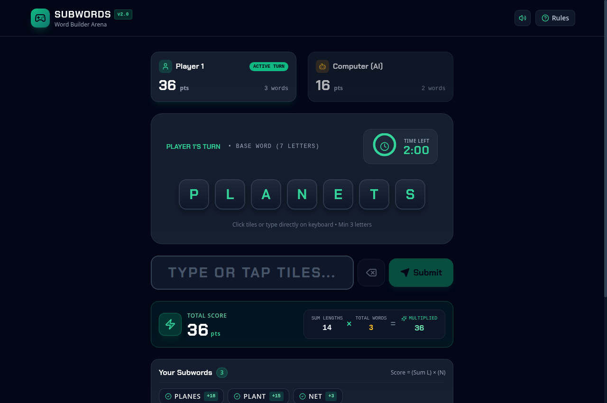
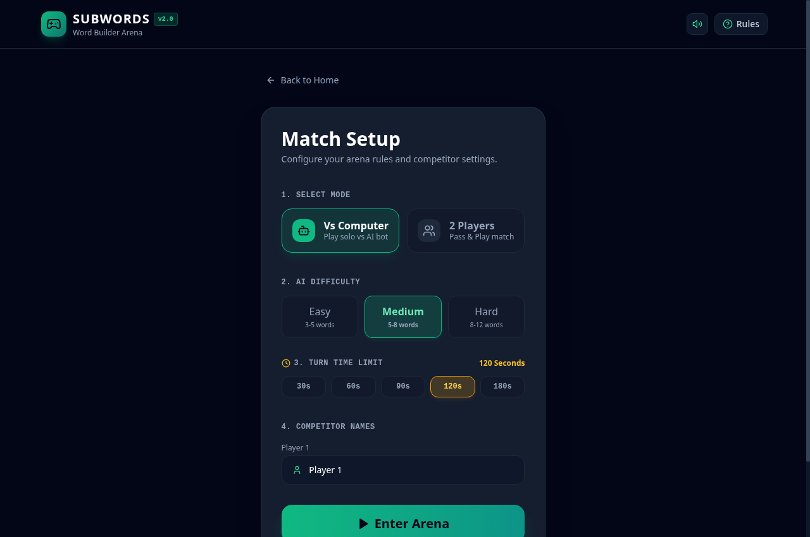
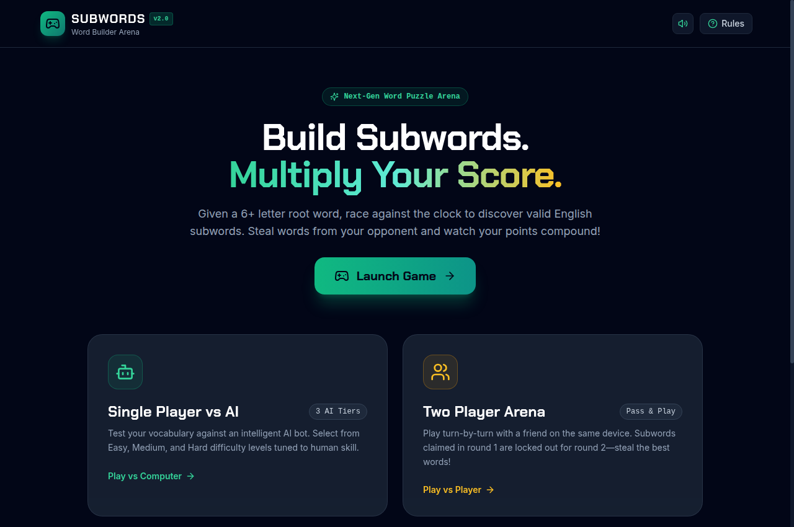
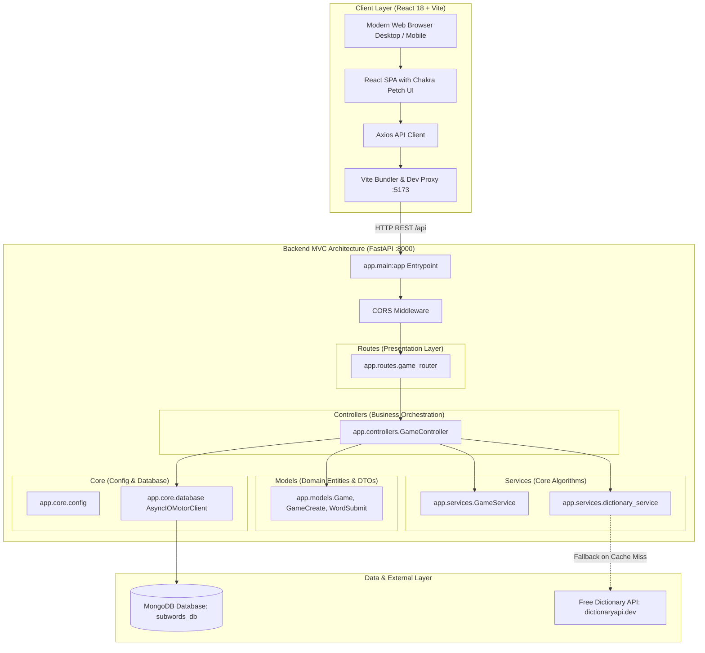

# Subwords Web Arena - Word Builder Game (v2.0)

A fast-paced, competitive word puzzle web application where players create valid English subwords from a randomly generated 6+ character base word within a configurable time limit. Features compounding multiplier scoring, competitor word-stealing lockout, and both Single Player (vs AI) and Two Player (Pass & Play) modes.



## 📸 Screenshots

| Live Gameplay Arena | Match Setup & Configuration |
| :---: | :---: |
|  |  |

| Cyber Arcade Home / Mode Selection |
| :---: |
|  |

## 📚 Project Documentation

A comprehensive documentation suite is maintained in the [`docs/`](docs/) directory:

- 📋 [**Product Requirements Document (PRD)**](docs/PRD.md): Business analyst specification covering user stories, acceptance criteria, personas, KPIs, and release scope.
- 🏗️ [**System Architecture Document**](docs/ARCHITECTURE.md): High-level system architecture, component breakdown, sequence diagrams, and MongoDB schema design.
- 🎨 [**System & UI/UX Design Document**](docs/DESIGN.md): Algorithmic complexity, dictionary lookup pipeline, design system tokens, typography, and screen layouts.
- 🐛 [**Bugs & Code Review Audit**](docs/BUGS.md): Defect register, security vulnerability audit (CVSS-rated), and post-upgrade resolution matrix.
- 📖 [**Usage & Operations Guide**](docs/USAGE.md): Complete setup instructions, configuration reference, API cheat sheet, and troubleshooting runbook.

> **Living Documentation Policy**: All relevant documents in `docs/` and this `README.md` are continuously updated alongside every code change.

---

## 🎮 Game Features & Mechanics (v2.0)

- **6+ Character Root Words**: Every match provides a base word with rich anagram permutations.
- **Configurable Session Timers**: Choose turn durations of 30s, 60s, 90s, 120s, or 180s.
- **Compounding Multiplier Scoring**: Points scale with both length and volume:
  $$\text{Total Score} = \left( \sum_{i=1}^{N} \text{Length}(W_i) \right) \times N$$
- **Competitor Word Lockout**: Subwords claimed by Player 1 cannot be reused by the competitor!
- **Single Player vs AI**: Play against an algorithmic AI bot with 3 difficulty tiers (Easy, Medium, Hard).
- **Humanized Real-Time AI Playback**: Watch the AI search for words and type them out letter-by-letter live on the arena board with sound effects, realistic pacing (1.1s–1.9s delays), live score compounding, and a "Skip to Results" option.
- **Two Player Arena**: Local pass-and-play turn competition on the same device.
- **Dual-Tier Lexical Validation**: High-speed in-memory hash set lookup ($O(1)$) with external Dictionary API fallback.
- **Interactive Controls**: Touch-friendly 3D letter tiles, click-to-type, and full physical keyboard support (A-Z, Backspace, Enter, Esc).

---

## 🛠 Tech Stack

- **Frontend**: React 18/19, Vite, TypeScript, Tailwind CSS, Lucide React, Canvas Confetti
- **Backend**: FastAPI (Python), Motor (Async MongoDB Driver), Pydantic v2, HTTPX
- **Database**: MongoDB (Local or Atlas)
- **Validation**: Hybrid In-Memory Dictionary (2,000+ words) + Free Dictionary API

---

## 🏗️ System Architecture

Subwords Web Arena uses a decoupled modern web architecture featuring a reactive **React 18/19 SPA** frontend and a modular **FastAPI MVC** backend with asynchronous MongoDB persistence:



---

## 🚀 Quickstart Guide

### 1. Start MongoDB
Ensure MongoDB is running locally or configured via `.env`:
```bash
sudo systemctl start mongod
```

### 2. Start Backend (FastAPI MVC Architecture)
```bash
cd backend
source .venv/bin/activate
uvicorn app.main:app --host 0.0.0.0 --port 8000 --reload
```
- API is available at: `http://localhost:8000`
- Swagger UI docs: `http://localhost:8000/docs`

### 3. Start Frontend (React Web App)
Open a new terminal:
```bash
cd frontend
npm install
npm run dev
```
- Web Application is available at: `http://localhost:5173`

### 4. Deploy to Render Cloud (Blueprint)
The repository includes an infrastructure-as-code [`render.yaml`](render.yaml) specification:
1. Push to GitHub and go to [Render Dashboard](https://dashboard.render.com).
2. Click **New +** -> **Blueprint** -> Select this repository.
3. Supply your free [MongoDB Atlas](https://www.mongodb.com/cloud/atlas) connection string for `MONGO_URL`.
4. Render automatically orchestrates the FastAPI web service, React SPA static site, and environment linking! See the [Render Deployment Guide](docs/USAGE.md#5-rendercom-cloud-deployment-guide) for details.

---

## 📁 Project Structure

```
subwords/
├── docs/
│   ├── PRD.md                 # Business Analyst Product Requirements Document
│   ├── ARCHITECTURE.md        # System architecture, sequence diagrams & schema
│   ├── DESIGN.md              # LLD algorithms & UI/UX design system
│   ├── BUGS.md                # Defect registry & vulnerability audit
│   ├── USAGE.md               # Setup, operations, API reference & runbook
│   └── screenshots/           # High-resolution application screenshots
├── backend/
│   ├── app/                   # MVC Architecture Package
│   │   ├── main.py            # FastAPI entrypoint, CORS, router mounting
│   │   ├── core/              # Config (settings) & database lifecycle (lifespan)
│   │   ├── models/            # Pydantic domain models (Game, GameCreate, etc.)
│   │   ├── services/          # Scoring engine, lockout, dictionary & AI bot algorithms
│   │   ├── controllers/       # Controller orchestrating DB queries & business logic
│   │   └── routes/            # API presentation router (/api endpoints)
│   ├── server.py              # Backward-compatible proxy to app.main:app
│   ├── dictionary.py          # Backward-compatible proxy to app.services.dictionary_service
│   ├── requirements.txt       # Streamlined core Python dependencies (6 packages)
│   ├── .env.example           # Backend environment template
│   └── .env                   # Backend environment variables (gitignored)
├── frontend/
│   ├── src/
│   │   ├── components/        # Navbar, LetterTile, TimerRing, WordLedger, etc.
│   │   ├── views/             # HomeView, SetupView, GameView, ResultsView
│   │   ├── services/          # Axios API service client
│   │   ├── utils/             # Web Audio API sound synthesizer (sound.ts)
│   │   ├── types/             # TypeScript definitions
│   │   ├── App.tsx            # View state machine
│   │   ├── main.tsx           # React entry point
│   │   └── index.css          # Tailwind CSS styles
│   ├── index.html             # HTML5 template with Google Fonts
│   ├── vite.config.ts         # Vite build configuration with chunk splitting & proxy
│   ├── tailwind.config.js     # Tailwind design tokens
│   ├── package.json           # React web dependencies
│   ├── .env.example           # Frontend environment template
│   └── .env                   # Frontend environment variables (gitignored)
├── .gitignore                 # Git ignore rules for Python, Node, OS & secrets
├── QUICKSTART.md              # Quick setup guide
└── README.md                  # Main project overview & documentation index
```

---

## 🎯 Game Rules Summary

1. Form valid English subwords using only the letters from the main word.
2. Words must be at least 3 letters long.
3. Letters cannot be used more times than they appear in the main word.
4. Words already claimed by a competitor cannot be reused.
5. Score compounds: $\text{Total Score} = (\text{Sum of Lengths}) \times (\text{Total Words})$.
6. Highest score wins!
