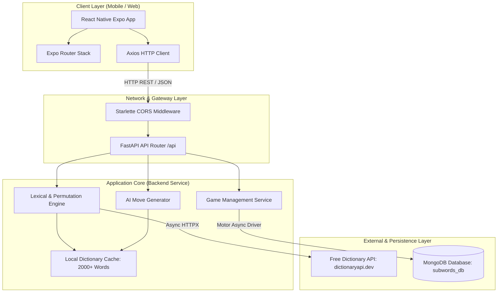
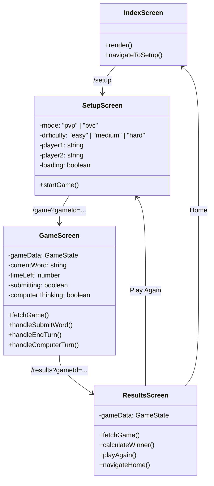
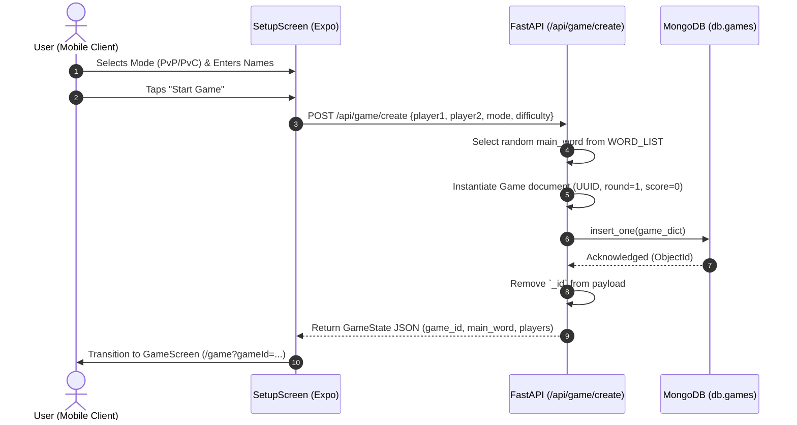
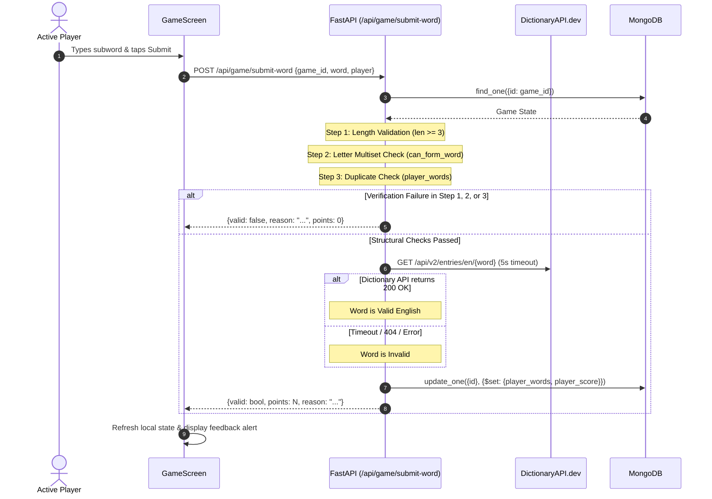
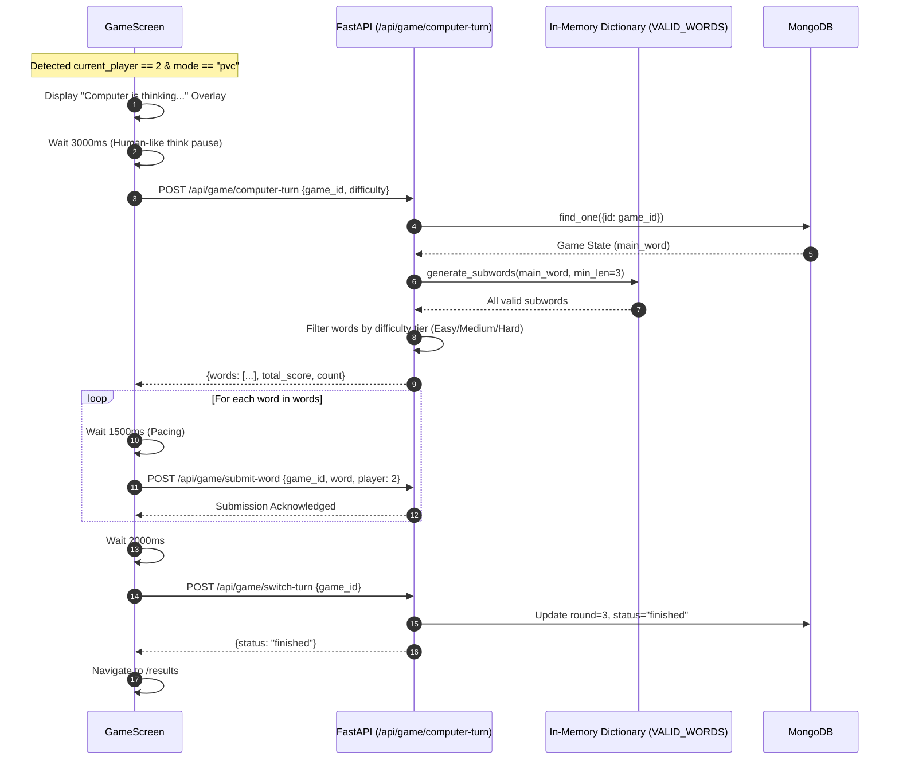
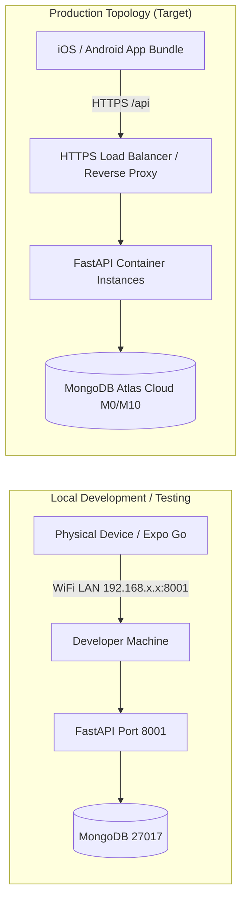

# System Architecture Document
## Word Builder Game (Subwords)

| Document Control | Details |
| :--- | :--- |
| **System** | Word Builder (Subwords) System Architecture |
| **Architecture Version** | 1.0.0 |
| **Architecture Pattern** | Decoupled Client-Server (Mobile SPA + Asynchronous REST API) |
| **Document Status** | Approved / Living Document |
| **Last Updated** | November 2026 |

---

## 1. Architectural Overview & Context

Word Builder follows a modern decoupled client-server architecture. The presentation layer is an Expo-powered React Native mobile application, communicating over an asynchronous JSON REST API with a FastAPI (Python) backend service. Persistent game state is stored in MongoDB via Motor (asynchronous driver), with dual-tier lexical validation utilizing both an in-memory dictionary and the Free Dictionary API.



---

## 2. Technology Stack Matrix

| Layer | Technology | Version | Rationale & Responsibility |
| :--- | :--- | :--- | :--- |
| **Frontend Framework** | React Native (Expo) | ~52.0.x / React 18.3.1 | Cross-platform mobile support (iOS, Android, Web) with rapid hot reloading and unified UI components. |
| **Frontend Navigation** | Expo Router | ~4.0.x | File-system-based routing with deep-linking, typed parameters, and native stack navigation. |
| **Frontend Networking** | Axios | ^1.7.9 | Promise-based HTTP client for asynchronous REST API communication with timeout control. |
| **Backend Framework** | FastAPI | >=0.100.0 | High-performance Python async web framework with automatic OpenAPI/Swagger docs and Pydantic validation. |
| **ASGI Server** | Uvicorn | Standard | Lightning-fast ASGI web server implementation for Python. |
| **Database Driver** | Motor (AsyncIOMotorClient) | Standard | Non-blocking async driver for MongoDB running on asyncio event loop. |
| **Persistence Store** | MongoDB | >=6.0 (Atlas / Community) | Document database providing dynamic schema flexibility for nested word lists and game session states. |
| **External HTTP Client** | HTTPX | Standard | Async HTTP client for Python used for concurrent external dictionary API verification. |
| **Validation & Schema** | Pydantic v2 | Standard | High-speed data modeling, request payload validation, and type safety. |

---

## 3. Component Architecture

### 3.1 Frontend Components (`frontend/app/`)



1. **`index.tsx` (Home Screen)**: Entry point displaying title branding, game rules summary, and navigation trigger to setup.
2. **`setup.tsx` (Configuration Screen)**: Handles user input for match type (PvP vs PvC), AI difficulty tuning, and player naming; dispatches `POST /api/game/create`.
3. **`game.tsx` (Active Match Screen)**: Manages real-time countdown timer (120s), reactive input forms, word submission dispatch, simulated AI playback loops, and turn state synchronization.
4. **`results.tsx` (Outcome Screen)**: Reads final match state from backend, computes winner/tie conditions, and renders scoreboards and word review feeds.

---

### 3.2 Backend Services (`backend/server.py`)

- **Routing Layer (`api_router`)**:
  - `GET /api/`: Health check and connectivity probe.
  - `POST /api/game/create`: Generates new game session with a randomized base word.
  - `GET /api/game/{game_id}`: Retrieves complete game state.
  - `POST /api/game/submit-word`: Validates letters, verifies dictionary existence, updates scores and word list.
  - `POST /api/game/switch-turn`: Advances player turn, increments round counter, marks game as `finished` after round 2.
  - `POST /api/game/computer-turn`: Generates AI move set filtered by difficulty rules.
  - `POST /api/validate-word`: Standalone endpoint for validating individual words.

---

## 4. End-to-End Sequence Diagrams

### 4.1 Game Initialization Flow



---

### 4.2 Word Submission & Dual-Tier Validation Flow



---

### 4.3 Computer AI Move Execution Flow (PvC Mode)



---

## 5. Data Architecture & MongoDB Schema

The system uses a single operational collection named `games` inside the `subwords_db` database.

### 5.1 `games` Document Schema Model

```json
{
  "_id": "ObjectId('...')",
  "id": "e4b2d184-7a32-4e89-9a67-9c98ef820d88",
  "main_word": "planet",
  "player1_name": "Alice",
  "player2_name": "Bob",
  "current_player": 1,
  "player1_words": [
    {
      "word": "plan",
      "valid": true,
      "points": 4
    },
    {
      "word": "lane",
      "valid": true,
      "points": 4
    }
  ],
  "player2_words": [
    {
      "word": "plant",
      "valid": true,
      "points": 5
    }
  ],
  "player1_score": 8,
  "player2_score": 5,
  "status": "active",
  "round": 1,
  "mode": "pvp",
  "difficulty": null,
  "created_at": "2026-11-03T06:00:00.000Z"
}
```

### 5.2 Schema Constraints & Indexing Strategy
- **Unique Primary Index**: `{ "id": 1 }` (UUID string, unique constraint ensures $O(1)$ lookup for all game actions).
- **TTL Index (Recommended for Production)**: `{ "created_at": 1 }, { expireAfterSeconds: 86400 }` to automatically clean up abandoned games after 24 hours.

---

## 6. Networking & Deployment Topology



---

## 7. Security & Architecture Quality Attributes

1. **Data Confidentiality & Credentials**:
   - Environment variables loaded exclusively via `python-dotenv` and Expo environment configurations.
   - Credentials strictly barred from version control via `.gitignore`.
2. **CORS Configuration**:
   - Currently permissive (`*`) for cross-device LAN development; production requires origin whitelisting (`subwords.app`).
3. **Resilience & Fault Tolerance**:
   - External Dictionary API call is wrapped in a strict 5.0-second timeout with non-blocking async execution.
   - Database operations use async non-blocking I/O preventing event loop starvation.
