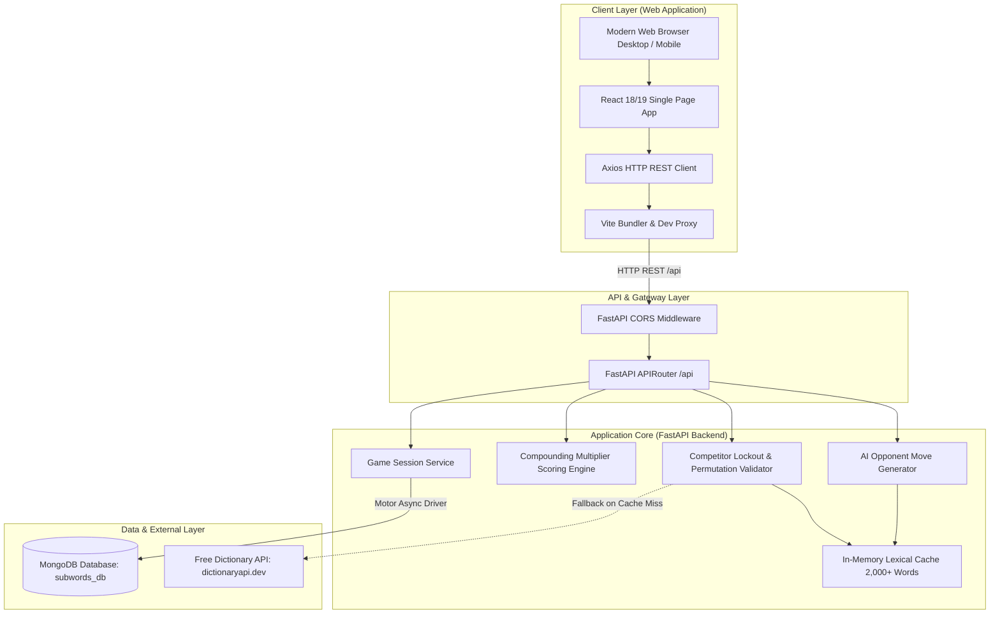
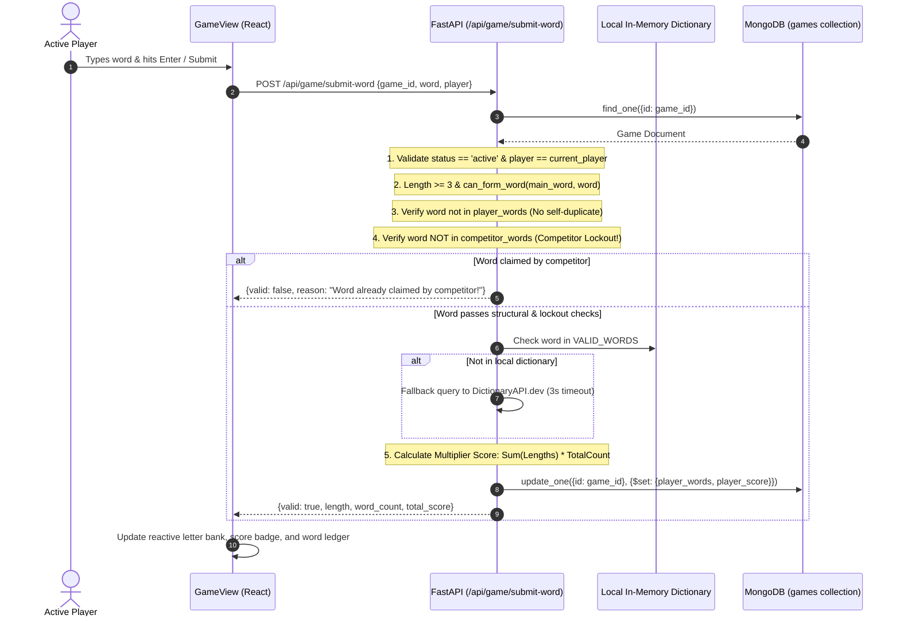

# System Architecture Document
## Word Builder Web Arena (Subwords)

| Document Control | Details |
| :--- | :--- |
| **System** | Subwords Web Arena System Architecture |
| **Architecture Version** | 2.0.0 (Web Revamp) |
| **Architecture Pattern** | Decoupled Client-Server (SPA Web App + Asynchronous REST API) |
| **Status** | Active / Baseline |
| **Last Updated** | November 2026 |

---

## 1. High-Level Architecture Overview

Word Builder Web Arena is architected as an asynchronous, decoupled web application. The frontend is a modern single-page web app built on **Vite + React 18/19 + Tailwind CSS**, communicating over HTTP/JSON with a high-performance **FastAPI** backend service. Persistent state is maintained in **MongoDB** via Motor async driver, with an in-memory lexical cache backed by an external Dictionary API fallback.

---

## 2. Technology Stack Matrix

| Layer | Component | Version | Role & Description |
| :--- | :--- | :--- | :--- |
| **Frontend Framework** | React + TypeScript | React 18.3.1 / TS 5.7 | Component-driven UI, state management, keyboard listeners. |
| **Build & Dev Tool** | Vite | 6.1.x | Lightning-fast HMR and optimized production bundling. |
| **Styling & Design** | Tailwind CSS | 3.4.x | Utility-first styling with custom game tokens and glassmorphism. |
| **Icons & Visuals** | Lucide React & Canvas Confetti | Latest | Vector iconography and particle celebration fireworks. |
| **HTTP Client** | Axios | 1.7.9 | Promise-based client with base URL proxying and interceptors. |
| **Backend Web Framework**| FastAPI | >=0.110.0 | High-performance Python async web framework with automatic OpenAPI. |
| **ASGI Web Server** | Uvicorn | >=0.25.0 | Lightning-fast ASGI server for asynchronous request handling. |
| **Database Driver** | Motor (AsyncIOMotorClient) | 3.3.x / 3.7.x | Non-blocking async driver for MongoDB running on asyncio event loop. |
| **Database Engine** | MongoDB | >=6.0 | Document database for storing game documents, word lists, and scores. |
| **External HTTP Client** | HTTPX | 0.28.x | Non-blocking async HTTP client for external dictionary lookups. |

---

## 3. End-to-End Sequence Diagrams

### 3.1 Word Submission with Competitor Lockout & Multiplier Scoring

---

## 4. Concurrency & Scalability Architecture

1. **Stateless Game Routing**: All game state transitions are identified by unique UUIDs (`game_id`). Any backend instance in a cluster can handle any turn request without sticky sessions.
2. **Database Indexing**:
   - Primary operational index: `{ "id": 1 }` (unique constraint, $O(1)$ query lookups).
   - Clean non-blocking async queries using `AsyncIOMotorClient`.
3. **In-Memory Lexical Cache**: Lookups against `VALID_WORDS` use Python set hashing with $O(1)$ time complexity, ensuring zero event loop blocking during high concurrent traffic.
