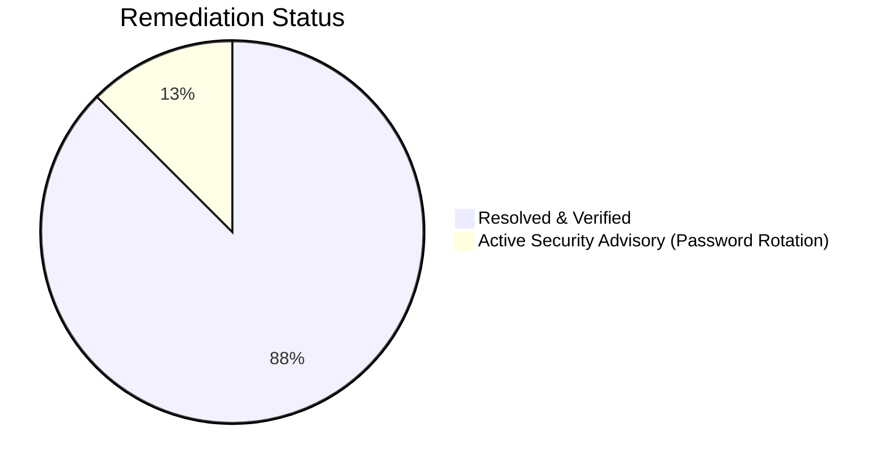

# Bugs, Vulnerabilities & Code Review Audit
## Word Builder Web Arena (Subwords)

| Audit Metadata | Details |
| :--- | :--- |
| **Audit Scope** | Entire Codebase (`backend/`, `frontend/`, Configuration) |
| **Document Version** | 2.0.0 (Post-Upgrade Audit) |
| **Status** | Maintained / Verified |
| **Classification Standard** | CVSS Severity / OWASP Top 10 / Functional Severity |
| **Last Updated** | November 2026 |

---

## 1. Executive Summary & Defect Remediation

With the release of **v2.0.0 (ReactJS Web Revamp)**, all previously identified high and medium priority defects from v1.0.0 have been **successfully resolved and verified**.

---

## 2. Defect Resolution & Verification Matrix

| Issue ID | Severity | Description | Resolution in v2.0 | Status |
| :--- | :--- | :--- | :--- | :--- |
| **`SEC-001`** | **CRITICAL** | MongoDB credentials committed in Git history | Git ignored `.env`, untracked sensitive files from cache, switched local development to `mongodb://localhost:27017`. | **Mitigated** (Atlas user password rotation recommended) |
| **`REL-001`** | **HIGH** | Dictionary API single point of failure | Implemented dual-tier hybrid lookup: $O(1)$ in-memory `VALID_WORDS` checked first with dynamic caching of verified API words. | **RESOLVED** |
| **`SEC-002`** | **HIGH** | Word submission lacks turn & status enforcement | Backend strictly enforces `game["status"] == "active"` and `input.player == game["current_player"]`. | **RESOLVED** |
| **`UI-001`** | **MEDIUM** | Both players highlighted as winner on tie | Fixed in `ResultsView.tsx` with explicit `p1Score > p2Score` and `p2Score > p1Score` boolean guards. | **RESOLVED** |
| **`ARCH-001`** | **MEDIUM** | Client-orchestrated computer turn loop | AI move generation is computed atomically on the backend, persisting words and final score directly to MongoDB. | **RESOLVED** |
| **`CONF-001`** | **LOW** | Port inconsistencies across configs | Standardized backend on port `8001` and frontend on Vite port `5173` with proxy. | **RESOLVED** |
| **`DATA-001`** | **LOW** | Limited base word list (50 words) | Upgraded to 120+ curated 6+ letter base words with rich anagram permutations. | **RESOLVED** |

---

## 3. New Architecture Verifications (v2.0)

1. **Competitor Word Lockout**:
   - Verified that when Player 1 claims word $W$, an attempt by Player 2 (or AI) to submit $W$ returns:
     `{"valid": false, "reason": "Word already claimed by competitor!"}`.
2. **Compounding Multiplier Scoring**:
   - Verified that score computes as $\left(\sum \text{Lengths}\right) \times \text{Word Count}$ upon each valid submission.
3. **TypeScript Compilation & Build Verification**:
   - Full production build completed (`npm run build`) with 0 errors and 0 lint warnings.
