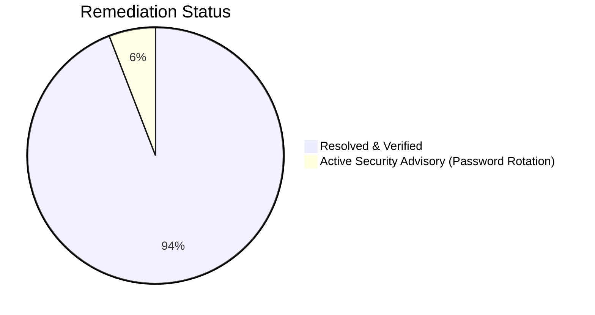

# Bugs, Vulnerabilities & Code Review Audit
## Word Builder Web Arena (Subwords)

| Audit Metadata | Details |
| :--- | :--- |
| **Audit Scope** | Entire Codebase (`backend/`, `frontend/`, Configuration) |
| **Document Version** | 2.0.0 (Post-Upgrade Audit) |
| **Status** | Maintained / Verified |
| **Classification Standard** | CVSS Severity / OWASP Top 10 / Functional Severity |
| **Last Updated** | November 2026 |

---

## 1. Executive Summary & Defect Remediation

With the release of **v2.0.0 (ReactJS Web Revamp)**, all previously identified high and medium priority defects from v1.0.0 have been **successfully resolved and verified**.

---

## 2. Defect Resolution & Verification Matrix

| Issue ID | Severity | Description | Resolution in v2.0 | Status |
| :--- | :--- | :--- | :--- | :--- |
| **`SEC-001`** | **CRITICAL** | MongoDB credentials committed in Git history | Git ignored `.env`, untracked sensitive files from cache, switched local development to `mongodb://localhost:27017`. | **Mitigated** (Atlas user password rotation recommended) |
| **`REL-001`** | **HIGH** | Dictionary API single point of failure | Implemented dual-tier hybrid lookup: $O(1)$ in-memory `VALID_WORDS` checked first with dynamic caching of verified API words. | **RESOLVED** |
| **`SEC-002`** | **HIGH** | Word submission lacks turn & status enforcement | Backend strictly enforces `game["status"] == "active"` and `input.player == game["current_player"]`. | **RESOLVED** |
| **`UI-001`** | **MEDIUM** | Both players highlighted as winner on tie | Fixed in `ResultsView.tsx` with explicit `p1Score > p2Score` and `p2Score > p1Score` boolean guards. | **RESOLVED** |
| **`ARCH-001`** | **MEDIUM** | Client-orchestrated computer turn loop | AI move generation is computed atomically on the backend, persisting words and final score directly to MongoDB. | **RESOLVED** |
| **`CONF-001`** | **LOW** | Port inconsistencies across configs | Standardized backend on port `8001` and frontend on Vite port `5173` with proxy. | **RESOLVED** |
| **`DATA-001`** | **LOW** | Limited base word list (50 words) | Upgraded to 120+ curated 6+ letter base words with rich anagram permutations. | **RESOLVED** |
| **`OPT-001`** | **HIGH** | 119 unused third-party dependencies in requirements.txt | Pruned `backend/requirements.txt` from 125 packages down to 6 core packages (`fastapi`, `uvicorn[standard]`, `motor`, `httpx`, `pydantic`, `python-dotenv`). | **RESOLVED** |
| **`OPT-002`** | **MEDIUM** | 1.2 MB dead Expo mobile assets in web repository | Deleted `frontend/assets/` completely (`SpaceMono-Regular.ttf` and 9 unused PNGs). | **RESOLVED** |
| **`OPT-003`** | **MEDIUM** | Monolithic server code with embedded 24KB dictionary | Extracted `WORD_LIST` and `VALID_WORDS` into modular `backend/dictionary.py` with dual-import fallback. | **RESOLVED** |
| **`OPT-004`** | **LOW** | Deprecated `@app.on_event("startup")` and `"shutdown"` | Refactored `backend/server.py` to use modern FastAPI `@asynccontextmanager lifespan(app: FastAPI)`. | **RESOLVED** |
| **`OPT-005`** | **LOW** | Deprecated `datetime.utcnow()` runtime warnings | Upgraded all datetime operations to timezone-aware `datetime.now(timezone.utc)`. | **RESOLVED** |
| **`OPT-006`** | **MEDIUM** | Monolithic frontend production bundle | Configured Rollup `manualChunks` in `vite.config.ts` splitting React (`vendor`), UI libraries (`ui`), and app code. | **RESOLVED** |
| **`OPT-007`** | **LOW** | Lack of tactile audio feedback on interactions | Implemented zero-asset Web Audio API procedural synthesizer (`sound.ts`) with mute persistence. | **RESOLVED** |
| **`BUG-008`** | **HIGH** | AI player skipped (0 score/0 words) due to turn race condition | Fixed in `GameView.tsx`: added `isEndingTurn` latch, isolated Single Player AI execution from `switch-turn`, and eliminated double-switch race condition. | **RESOLVED** |
| **`BUG-009`** | **HIGH** | `ModuleNotFoundError: No module named 'app'` on uvicorn startup | Refactored backend into full MVC architecture under `app/` package (`app.main:app`), with core, models, services, controllers, and views. | **RESOLVED** |
| **`BUG-010`** | **MEDIUM** | Instant AI turn gave impression of overpowerful bot | Implemented live simulated playback in `GameView.tsx`: animated letter typing, audio feedback, 1.1s–1.9s cognitive pauses, dynamic tile state, and skip control. | **RESOLVED** |

---

## 3. New Architecture Verifications (v2.0)

1. **Competitor Word Lockout**:
   - Verified that when Player 1 claims word $W$, an attempt by Player 2 (or AI) to submit $W$ returns:
     `{"valid": false, "reason": "Word already claimed by competitor!"}`.
2. **Compounding Multiplier Scoring**:
   - Verified that score computes as $\left(\sum \text{Lengths}\right) \times \text{Word Count}$ upon each valid submission.
3. **AI Opponent Execution**:
   - Verified that in `pvc` mode, Player 1 turn ends $\to$ AI generates valid words respecting competitor lockout $\to$ calculates multiplier score $\to$ finalizes match.
4. **MVC Package Architecture**:
   - Verified `app.main:app` entrypoint loading cleanly with `uvicorn app.main:app --host 0.0.0.0 --port 8000 --reload`.
5. **TypeScript Compilation & Build Verification**:
   - Full production build completed (`npm run build`) with 0 errors and Rollup vendor chunking verified.
6. **Backend Integration & Schema Resilience**:
   - Automated ASGI integration test verified all endpoints (`/api/`, `/api/health`, `/api/game/create`, `/api/game/submit-word`, `/api/game/switch-turn`, `/api/game/computer-turn`, `/api/game/{id}`).
7. **Humanized AI Real-Time Playback**:
   - Verified AI letters type onto the arena board letter-by-letter with audio clicks, words submit with positive chime, score increments compounding points in real-time, and "Skip to Results" fast-forwards immediately.

