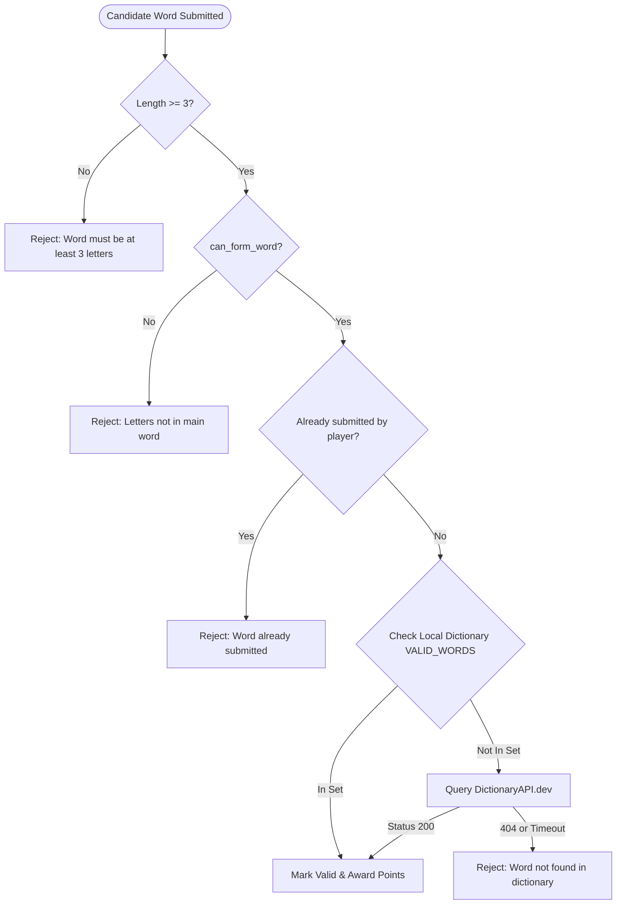
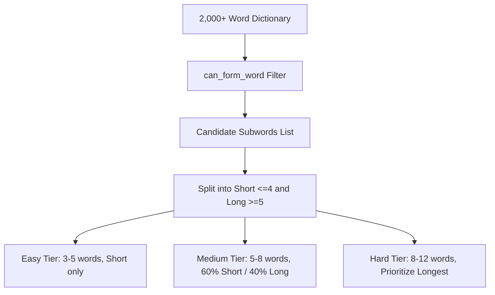

# System & UI/UX Design Document
## Word Builder Game (Subwords)

| Document Metadata | Details |
| :--- | :--- |
| **System** | Word Builder (Subwords) Detailed Design |
| **Design Version** | 1.0.0 |
| **Scope** | Low-Level System Design (LLD), Algorithms & UI/UX Design System |
| **Last Updated** | November 2026 |

---

## 1. Low-Level System Design (LLD) & Algorithms

### 1.1 Letter Multiset Subtraction Algorithm (`can_form_word`)

The fundamental validation rule requires verifying that every letter in the candidate `sub_word` exists in `main_word` with an equal or greater frequency.

#### Current Implementation Analysis
```python
def can_form_word(main_word: str, sub_word: str) -> bool:
    main_letters = list(main_word.lower())
    for letter in sub_word.lower():
        if letter in main_letters:
            main_letters.remove(letter)
        else:
            return False
    return True
```
- **Complexity**:
  - Converting `main_word` to list: $O(M)$ where $M$ is length of `main_word`.
  - In the worst case, searching and removing `letter` from `main_letters` takes $O(M)$ time for each of the $N$ letters in `sub_word`.
  - Total Time Complexity: $O(N \cdot M)$.
  - Space Complexity: $O(M)$ for the letter list.

#### Recommended Optimized Implementation (Frequency Counter)
Using a frequency map (or Python `collections.Counter`):
$$\forall c \in \Sigma, \quad \text{Count}_{\text{sub\_word}}(c) \le \text{Count}_{\text{main\_word}}(c)$$
- **Optimized Time Complexity**: $O(M + N)$ linear time.
- **Optimized Space Complexity**: $O(|\Sigma|) = O(1)$ since English alphabet has at most 26 lowercase characters.

```python
from collections import Counter

def can_form_word_optimized(main_word: str, sub_word: str) -> bool:
    main_counts = Counter(main_word.lower())
    sub_counts = Counter(sub_word.lower())
    for char, count in sub_counts.items():
        if main_counts[char] < count:
            return False
    return True
```

---

### 1.2 Lexical Dictionary Validation Strategy

Word Builder uses a **Dual-Tier Validation Pipeline**:



1. **Tier 1 (In-Memory Hash Set)**:
   - `VALID_WORDS` contains 2,000+ pre-compiled common English words.
   - Hash set membership lookup has $O(1)$ average time complexity.
2. **Tier 2 (External HTTP REST API)**:
   - Endpoint: `https://api.dictionaryapi.dev/api/v2/entries/en/{word}`.
   - Executed via `httpx.AsyncClient` with a strict `5.0s` timeout.

---

### 1.3 Computer Opponent AI Algorithm & Difficulty Tuning

The AI opponent calculates moves using the `generate_subwords` routine, filtering the dictionary down to all candidate subwords that satisfy `can_form_word(main_word, candidate)`.



#### Difficulty Matrices:
| Level | Target Word Count | Length Distribution | Pacing Delay | Target Total Score Range |
| :--- | :--- | :--- | :--- | :--- |
| **Easy** | 3–5 words | 100% Short words (3–4 letters) | 1,500ms per word | 9–18 points |
| **Medium** | 5–8 words | 60% Short (3–4 letters), 40% Long (5+ letters) | 1,500ms per word | 20–35 points |
| **Hard** | 8–12 words | 80% Long (5+ letters), 20% Short | 1,500ms per word | 35–65 points |

---

## 2. Frontend UI/UX Design System

### 2.1 Design Philosophy & Aesthetic
Word Builder employs an immersive, distraction-free **Dark Arcade Theme**. The aesthetic pairs deep midnight blue foundations with high-energy emerald green indicators and amber action accents, creating high contrast that minimizes eye strain on mobile OLED displays.

### 2.2 Color Tokens & Palette

| Token Name | Hex Code | Visual Swatch Role | Usage Context |
| :--- | :--- | :--- | :--- |
| `--color-bg-base` | `#1a1a2e` | Deep Space Navy | Full application background canvas |
| `--color-surface-card`| `#16213e` | Dark Slate Blue | Containers, input wrappers, rules cards, scoreboards |
| `--color-surface-accent`|`#0f3460` | Royal Indigo Accent | Selected mode chips, main word marquee container |
| `--color-primary-green`|`#4CAF50` | Emerald Green | Primary CTA buttons, checkmarks, timer active state |
| `--color-action-amber` |`#FF9800` | Bright Amber | "End Turn" button, Player 2 icon |
| `--color-danger-red`   |`#f44336` | Coral Red | Timer warning state ($< 30$s), rejected word badges |
| `--color-trophy-gold`  |`#FFD700` | Golden Yellow | Winner trophy icon, winner card borders |
| `--color-text-primary` |`#ffffff` | Pure White | Screen titles, active words, primary labels |
| `--color-text-muted`   |`#bbbbbb` | Light Gray | Subtitles, player names, rules body |
| `--color-text-dim`     |`#666666` | Charcoal Slate | Unselected icons, placeholder text |

---

### 2.3 Typography Scale

| Hierarchy | Size | Weight | Letter Spacing | Element Example |
| :--- | :--- | :--- | :--- | :--- |
| **Hero Title** | 48px | Bold (700) | Normal | Home Screen Title ("Word Builder") |
| **Screen Title** | 36px | Bold (700) | Normal | Setup Screen & Results Screen Headers |
| **Word Marquee** | 36px | Bold (700) | 4px | Main Word Display (`P L A N E T`) |
| **Score Value** | 32px – 42px | Bold (700) | Normal | Player Score Numerical Values |
| **CTA Button Text**| 20px – 24px | Bold (700) | Normal | "Start Game", "End Turn" Buttons |
| **Body / Inputs** | 16px – 18px | Regular (400) | Normal | Input Text Field, Rules Text |
| **Caption / Meta** | 12px – 14px | Regular (400) | Normal | Difficulty Descriptions, Card Labels |

---

## 3. Screen Layout & Interaction Design

```
+------------------------------------------+
|  <- Game Setup                           |
|                                          |
|  Select Mode:                            |
|  [ (o) Player vs Player ] [ Player vs AI]|
|                                          |
|  Select Difficulty (AI only):            |
|  [ Easy (3-5) ] [ Medium ] [ Hard (8-12)]|
|                                          |
|  Player Names:                           |
|  [ [o] Player 1 Name: Alice            ] |
|  [ [o] Player 2 Name: Bob              ] |
|                                          |
|  [========== START GAME ==========]      |
+------------------------------------------+
```

### 3.1 Screen Breakdown

#### 1. Home Screen (`index.tsx`)
- Centered brand emblem with game-controller icon (`#4CAF50`).
- High-elevation "Start New Game" button.
- Embedded "How to Play" rule card summarizing round limits, word length minimums, and scoring formulas.

#### 2. Setup Screen (`setup.tsx`)
- Interactive mode toggle cards with iconography.
- Dynamic difficulty selector with micro-descriptions (e.g., "3-5 words", "5-8 words").
- Form inputs with inline icons and character limits (`maxLength=20`).
- Keyboard dismiss and offset adjustment via `KeyboardAvoidingView`.

#### 3. Game Screen (`game.tsx`)
- **Header Scoreboard**: Head-to-head score comparison with prominent player badges and "VS" separator.
- **Main Word Hero Card**: Uppercase high-contrast letter banner.
- **Turn Bar**: Active player indicator alongside a reactive timer with dynamic color shifting at 30 seconds.
- **Submission Bar**: Fixed text input with inline quick-tap checkmark submit button.
- **Scrollable Word Ledger**: Real-time record of all submitted words with pass/fail indicators and point badges.
- **AI Turn Overlay**: Full-screen semi-transparent modal with spinner when computer generates moves.

#### 4. Results Screen (`results.tsx`)
- Golden trophy badge and bold victory banner.
- Highlighted winner card featuring glowing gold border (`#FFD700`).
- Detailed comparison of words found by each player.
- Instant replay CTA ("Play Again") and Return Home CTA.

---

## 4. Accessibility (A11y) & Ergonomics

1. **Touch Targets**: All interactive elements (buttons, difficulty chips, submit controls) exceed the $48 \times 48\text{dp}$ touch target guideline.
2. **Contrast Ratio**: White text on `#1a1a2e` and `#16213e` yields a contrast ratio $> 11:1$, comfortably passing WCAG 2.1 AAA.
3. **Keyboard Handling**: `KeyboardAvoidingView` with platform-specific behavior (`ios: padding`, `android: height`) prevents input fields from being obscured by software keyboards.
