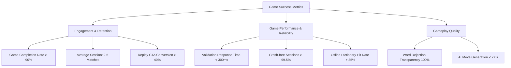
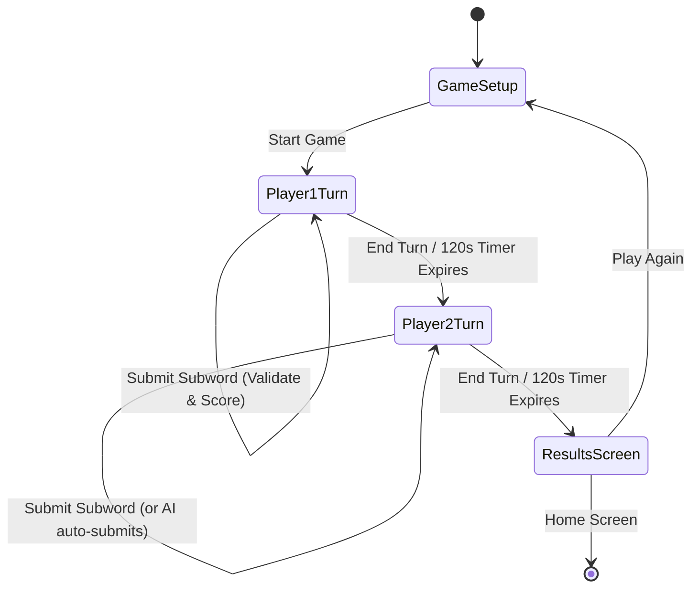

# Product Requirements Document (PRD)
## Word Builder Game (Subwords)

| Document Metadata | Value |
| :--- | :--- |
| **Product Name** | Word Builder (Subwords) |
| **Document Version** | 1.0.0 |
| **Document Status** | Approved / Baseline |
| **Author** | Business Analyst & Product Architecture Team |
| **Target Audience** | Engineering, QA, UI/UX, Product Management, Stakeholders |
| **Last Updated** | November 2026 |

---

## 1. Executive Summary & Vision

### 1.1 Product Vision
Word Builder is a mobile-first turn-based word puzzle game designed for casual and competitive players. The core objective is simple yet intellectually stimulating: given a randomly generated base word (5+ letters), players compete to identify and submit valid English subwords constructed exclusively from the letters of that base word within a time-constrained turn.

### 1.2 Value Proposition
- **Accessible & Engaging**: Quick 120-second rounds encourage active vocabulary recall and fast-paced gameplay.
- **Multiple Modes**: Supports shared single-device local multiplayer (Pass-and-Play) and challenging single-player gameplay against an intelligent AI bot with tiered difficulties.
- **Educational & Fair**: Real-time validation backed by linguistic dictionaries guarantees fair play and immediate score feedback.

---

## 2. Problem Statement & Market Opportunity

### 2.1 Problem Statement
Many mobile word games are either:
1. Heavily monetized with intrusive advertisements, microtransactions, and pay-to-win boosters.
2. Complex tile-grid games (e.g., Scrabble, Boggle) requiring long match durations (15–45 minutes) that don't fit quick micro-session mobile usage.
3. Requiring continuous cloud matchmaking and persistent internet connections for 2-player games, making couch co-op or offline/low-latency pass-and-play frustrating.

### 2.2 Market Solution
Word Builder provides a zero-friction, ad-free, 2-round mobile game experience where matches resolve in under 4 minutes, supporting both local couch multiplayer and offline/online AI bot play.

---

## 3. User Personas & Target Audience

| Persona | Demographics & Context | Motivations & Goals | Pain Points Addressed |
| :--- | :--- | :--- | :--- |
| **Persona A: Casual Casey** (Social/Casual Gamer) | Age 22–38; plays during commutes, breaks, or with friends on the couch. | Wants quick 2-to-4 minute engaging matches with a friend on one phone without complex setup. | Eliminates account registration hurdles and network sync drops through local pass-and-play. |
| **Persona B: Solo Sam** (Puzzle Enthusiast) | Age 16–50; enjoys solo brain training, word puzzles, crosswords. | Wants to practice vocabulary against balanced AI opponents of escalating difficulty. | Provides 3 distinct AI tiers (Easy, Medium, Hard) that dynamically choose words matching human skill levels. |
| **Persona C: Competitive Charlie** (High Scorer) | Age 18–35; competitive gamer targeting maximum word combinations and score optimization. | Wants strict lexical validation, clear rules, and transparent scoring based on subword length. | Instant feedback on invalid letters, minimum word length constraints, and duplicate word prevention. |

---

## 4. Business Goals & Key Performance Indicators (KPIs)

### 4.1 Business & Product Goals
- Provide an intuitive, low-friction mobile experience with time-to-first-turn under 15 seconds from app launch.
- Achieve sub-300ms word validation response times.
- Ensure 100% dictionary accuracy and fair letter-count validation.

### 4.2 Measurable Success Metrics (KPIs)



---

## 5. Scope & Release Phases

### 5.1 In-Scope (Phase 1 - Current MVP)
- **Local Multiplayer (PvP)**: 2 players sharing the same mobile screen via pass-and-play.
- **Player vs Computer (PvC)**: 1 player competing against an algorithmic AI bot with 3 difficulty modes:
  - *Easy*: 3–5 short words (3–4 letters).
  - *Medium*: 5–8 mixed words (3–6 letters).
  - *Hard*: 8–12 words (prioritizing maximum length).
- **Core Mechanics**:
  - Random base word selection (curated list, length $\ge$ 5).
  - 120-second countdown timer per player turn.
  - Multiset character subtraction validation (cannot use more letters than available).
  - Minimum word length rule: 3 characters.
  - Scoring: 1 point per letter (Points = Length of Valid Word).
  - Lexical validation using Dictionary API with local fallback dictionary.
  - Game state persistence in MongoDB.
  - Comprehensive results screen with winner declaration, score summary, and detailed word log.

### 5.2 Out-of-Scope (Future Releases / Roadmap)
- Remote online multiplayer over WebSockets / WebRTC.
- Global leaderboards and player profiles with Elo ratings.
- In-game currency, cosmetic letter tiles, or premium themes.
- Audio sound effects, background music, and haptic feedback toggles.
- Daily challenges and push notifications.

---

## 6. Functional Requirements & User Stories

### 6.1 Epic 1: Game Initialization & Setup

#### User Story 1.1: Mode Selection
> **As a** player,  
> **I want to** choose between "Player vs Player" and "Player vs Computer" modes,  
> **So that** I can play alone against AI or with a friend next to me.

- **Acceptance Criteria**:
  - Default selection must be "Player vs Player".
  - Switching mode updates the UI dynamically without page reloads.
  - Selecting "Player vs Computer" displays the Difficulty Selection section and sets Player 2 to "Computer".

#### User Story 1.2: Difficulty Configuration (PvC Mode)
> **As a** solo player,  
> **I want to** pick between Easy, Medium, and Hard difficulty levels,  
> **So that** the computer opponent matches my skill level.

- **Acceptance Criteria**:
  - Tiers available: Easy (3–5 words), Medium (5–8 words), Hard (8–12 words).
  - Medium is selected by default.
  - Only one difficulty can be active at a time.

#### User Story 1.3: Player Name Input & Validation
> **As a** player,  
> **I want to** enter custom player names (up to 20 characters),  
> **So that** our scores and turns are personalized.

- **Acceptance Criteria**:
  - Input fields restrict names to maximum 20 characters.
  - Empty or whitespace-only names are blocked with an alert message.
  - In PvC mode, Player 2 name is pre-populated as "Computer" and locked.

---

### 6.2 Epic 2: Core Gameplay & Turn Mechanics



#### User Story 2.1: Main Word Display
> **As an** active player,  
> **I want to** clearly see the uppercase main word prominently displayed at all times,  
> **So that** I can analyze available letters during my turn.

- **Acceptance Criteria**:
  - The main word is displayed in bold uppercase with expanded letter-spacing.
  - Letters cannot change mid-game for either player in a match.

#### User Story 2.2: Turn Timer (120 Seconds)
> **As a** player,  
> **I want to** see an active countdown timer for my turn,  
> **So that** I know how much time I have remaining.

- **Acceptance Criteria**:
  - Turn begins at 120 seconds (`02:00`).
  - Timer decrements by 1 second every 1000ms.
  - When remaining time is $< 30$ seconds, timer display color transitions from green (`#4CAF50`) to warning red (`#f44336`).
  - When timer reaches 0, the turn automatically ends and transfers to the next player or results screen.

#### User Story 2.3: Manual Turn Termination
> **As a** player who has exhausted all known words,  
> **I want to** manually tap "End Turn",  
> **So that** I do not have to wait for the remaining countdown time.

- **Acceptance Criteria**:
  - An "End Turn" button is clearly visible during human turns.
  - Tapping ends the active turn immediately, clears any pending input, and prompts the turn switch.

---

### 6.3 Epic 3: Word Submission & Linguistic Validation

#### User Story 3.1: Subword Construction & Letter Rules
> **As an** active player,  
> **I want to** submit words formed from the main word's letters,  
> **So that** only valid permutations receive points.

- **Acceptance Criteria**:
  - **Length Constraint**: Words $< 3$ characters are rejected with reason: `"Word must be at least 3 letters"`.
  - **Character Multiset Constraint**: A letter can only be used up to the number of times it appears in the main word. Violations rejected with reason: `"Word cannot be formed from main word"`.
  - **Duplicate Constraint**: Submitting a word previously submitted by the same player is rejected with: `"Word already submitted"`.
  - **Case Insensitivity**: Submission is case-insensitive (e.g., `tea`, `Tea`, `TEA` are treated identically).

#### User Story 3.2: Lexical Dictionary Verification
> **As a** player,  
> **I want to** ensure words are verified against recognized English dictionaries,  
> **So that** non-words or gibberish cannot earn points.

- **Acceptance Criteria**:
  - Validates against Dictionary API (`https://api.dictionaryapi.dev/api/v2/entries/en/{word}`).
  - Falls back gracefully to the embedded 2,000+ local dictionary when offline or upon API timeout.
  - Valid words grant points equal to their length ($L \ge 3$).
  - Invalid words receive 0 points and display an error alert.

---

### 6.4 Epic 4: Artificial Intelligence (AI) Opponent

#### User Story 4.1: AI Word Generation & Realistic Pacing
> **As a** solo player playing against the computer,  
> **I want** the computer opponent to play realistically with human-like delays,  
> **So that** the game feels natural rather than instant.

- **Acceptance Criteria**:
  - An initial 3-second "Computer is thinking..." modal overlay appears.
  - The computer submits words one by one with a 1.5-second stagger interval between submissions.
  - Each word dynamically appears in the Computer's word log in real-time.
  - Word selection strictly respects the selected difficulty tier.

---

### 6.5 Epic 5: Results, Scoring & Match Resolution

#### User Story 5.1: Match Outcome & Word History
> **As a** player completing round 2,  
> **I want to** see the final scores, the declared winner, and full word lists,  
> **So that** we can review each other's submissions.

- **Acceptance Criteria**:
  - Winner is determined: Player with the higher total score wins. If scores are equal, "It's a Tie!" is declared.
  - Displays total scores, total word count, and full list of valid words for both players.
  - Provides two clear call-to-action buttons: "Play Again" (navigates to `/setup`) and "Home" (navigates to `/`).

---

## 7. Non-Functional Requirements (NFRs)

### 7.1 Performance Requirements
- **API Response Latency**: Core endpoints (`/api/game/create`, `/api/game/switch-turn`) must respond in $< 100$ms under normal load.
- **Dictionary Validation**: Word validation must return within $< 500$ms; local dictionary lookups within $< 5$ms.
- **Client Frame Rate**: React Native UI animations and inputs must maintain a smooth 60 FPS on iOS and Android devices.

### 7.2 Reliability & Availability
- **Graceful Degradation**: If external DictionaryAPI.dev is unavailable, the application must automatically fall back to the built-in dictionary without failing the request.
- **Client Connection Resilience**: If network drops momentarily, user inputs should not crash the app.

### 7.3 Usability & Design Guidelines
- Mobile-first dark theme (`#1a1a2e`, `#16213e`) with high-contrast accessibility compliance (WCAG 2.1 AA).
- Minimum touch target size: 48x48dp for all buttons.
- Full support for on-screen virtual keyboard with `KeyboardAvoidingView`.

### 7.4 Security & Data Privacy
- **Zero Sensitive Data Stored**: No PII (personally identifiable information), passwords, or financial data collected.
- **Input Sanitization**: User inputs stripped of whitespace, lowercased, and sanitized against injection.
- **Database Credentials**: Secure credential management via `.env` (excluded from version control).

---

## 8. Business Rules & Mathematical Scoring Engine

```
Rule 1: Subword Permutation Rule
Let M be the multiset of letters in MainWord.
Let W be the multiset of letters in Subword.
Valid if and only if W ⊆ M and |W| >= 3.

Rule 2: Scoring Formula
Score(W) = |W| (length of string W) if IsValidEnglishWord(W) == True, else 0.

Rule 3: Match Duration Rule
Max Rounds = 2 (Round 1: Player 1, Round 2: Player 2 / AI).
Max Turn Duration = 120 seconds.
Match Total Duration <= 240 seconds + transition overhead.
```

---

## 9. Risks, Dependencies & Mitigation Strategies

| Risk | Impact | Likelihood | Mitigation Strategy |
| :--- | :--- | :--- | :--- |
| **DictionaryAPI.dev Rate Limiting / Outage** | High | Medium | Implement local dictionary fallback cache + pre-check in `VALID_WORDS` set. |
| **Network latency across local WiFi in Expo Go** | Medium | High | Support localhost / LAN IP configuration with clear diagnostic error alerts. |
| **Client timer manipulation / spoofing** | Low | Low | Phase 2 will introduce server-side authoritative timestamp validation. |
| **Exposure of MongoDB connection string in repo** | Critical | High | Add `.gitignore` (completed) and rotate credentials immediately. |

---

## 10. Acceptance Sign-Off

| Stakeholder Role | Name / Title | Status | Date |
| :--- | :--- | :--- | :--- |
| **Lead Product Manager** | Word Builder PM Team | Approved | Nov 2026 |
| **Lead Solution Architect** | Core Architecture | Approved | Nov 2026 |
| **QA Lead** | Mobile & API QA | Approved | Nov 2026 |
