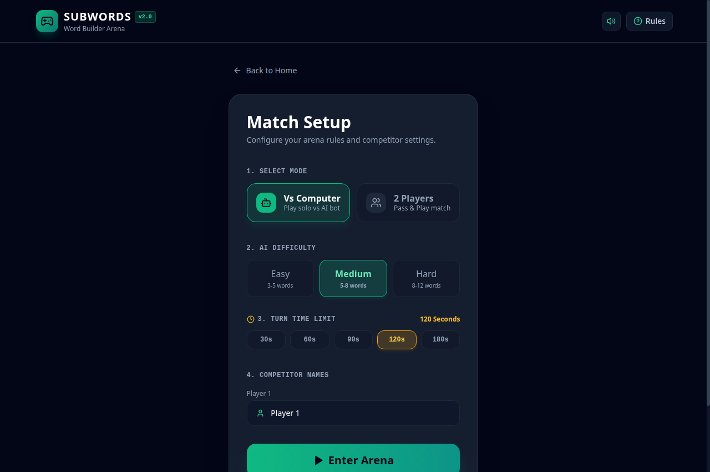
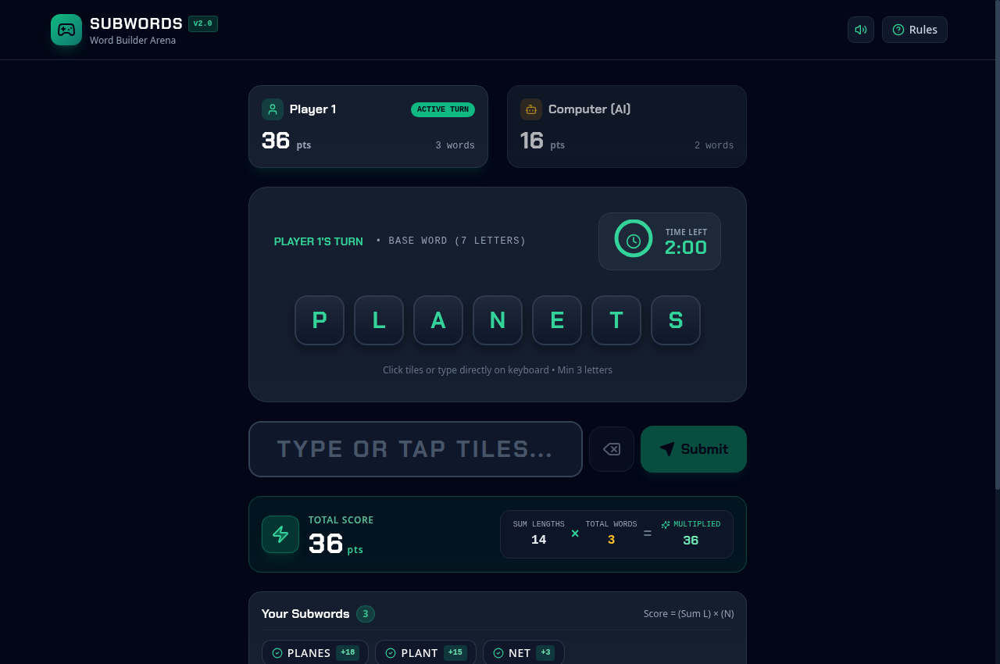

# Usage & Developer Operations Guide
## Word Builder Web Arena (Subwords)

| Document Metadata | Details |
| :--- | :--- |
| **Document** | Developer Operations & User Gameplay Guide |
| **Document Version** | 2.0.0 (Web Revamp) |
| **Target Audience** | Developers, Testers, Operators, End Users |
| **Last Updated** | November 2026 |

---

## 1. Prerequisites & Environment Setup

| Component | Minimum Version | Recommended | Verification Command |
| :--- | :--- | :--- | :--- |
| **Node.js** | v18.0.0 | v20.x or v22.x LTS | `node -v` |
| **npm** | v9.0.0 | v10.x | `npm -v` |
| **Python** | 3.9+ | 3.11+ / 3.14+ | `python3 --version` |
| **MongoDB** | 5.0+ | MongoDB Community or Atlas | `mongosh --eval "db.runCommand({ping: 1})"` |

---

## 2. Step-by-Step Installation & Quickstart

### 2.1 Backend Execution (FastAPI)

1. **Navigate to the backend directory**:
   ```bash
   cd /home/amit.bora/Downloads/ai/subwords/backend
   ```

2. **Activate the Python virtual environment**:
   ```bash
   source .venv/bin/activate
   ```
   *(If initializing on a new machine: `python3 -m venv .venv && pip install -r requirements.txt`)*

3. **Verify Environment Configuration** (`backend/.env`):
   ```env
   MONGO_URL="mongodb://localhost:27017"
   DB_NAME="subwords_db"
   ```

4. **Launch the FastAPI Server (MVC Architecture)**:
   ```bash
   uvicorn app.main:app --host 0.0.0.0 --port 8000 --reload
   ```
   *(Legacy command `uvicorn server:app` is also supported via compatibility proxy).*
   - **Base URL**: `http://localhost:8000`
   - **Interactive OpenAPI (Swagger)**: `http://localhost:8000/docs`
   - **Health Probe**: `http://localhost:8000/api/`

---

### 2.2 Frontend Execution (ReactJS Web App)

1. **Navigate to the frontend directory** (in a separate terminal):
   ```bash
   cd /home/amit.bora/Downloads/ai/subwords/frontend
   ```

2. **Install dependencies** (if not already installed):
   ```bash
   npm install
   ```

3. **Launch the Vite Development Server**:
   ```bash
   npm run dev
   ```
   - **Web Arena URL**: `http://localhost:5173`
   - Vite automatically proxies `/api` requests to `http://localhost:8000`.

4. **Build for Production**:
   ```bash
   npm run build
   ```

---

## 3. End-User Gameplay Walkthrough

| Match Setup | Live Arena Gameplay |
| :---: | :---: |
|  |  |

### 3.1 Single Player vs AI Mode
1. Open `http://localhost:5173` in your browser $\to$ Click **"Launch Game"**.
2. Select **"Vs Computer"** mode.
3. Choose difficulty tier:
   - **Easy**: AI claims 3–5 short subwords.
   - **Medium**: AI claims 5–8 mixed subwords.
   - **Hard**: AI claims 8–12 subwords, prioritizing maximum length.
4. Select turn time limit (e.g., 60s) $\to$ Enter your name $\to$ Click **"Enter Arena"**.
5. **Your Turn**:
   - Tap letter tiles or type on your keyboard to form valid subwords from the 6+ letter root.
   - Press **Enter** to submit. Watch your total score increase (1 point per letter):
     $$\text{Score} = \sum \text{Length}(W_i)$$
   - Click **"Finish Turn Early"** or let the timer expire.
6. **AI Turn (Humanized Real-Time Playback)**:
   - The AI takes its turn live directly on the arena board!
   - Watch the computer contemplate (1.1s–1.9s pauses) and type subwords letter-by-letter with audio clicks.
   - The board tiles decrement remaining letter frequencies dynamically, and Player 2's score compounds in real-time.
   - You can watch the full demonstration or click **"Skip to Results"** at any moment to fast-forward straight to the post-game summary.
7. **Victory Screen**:
   - Final scores and comparative subwords lists are reviewed with celebration confetti!

---

### 3.2 Two Player Arena (Pass & Play)
1. Select **"2 Players"** mode.
2. Select time limit (e.g., 90s) and enter names for Player 1 and Player 2.
3. **Round 1**: Player 1 submits subwords.
4. **Round 2**: Player 2 takes their turn.
   - **Crucial Rule**: Player 2 cannot submit words already claimed by Player 1!
5. **Results**: Winner is declared based on highest compounded score.

---

## 4. Backend REST API Cheat Sheet

### 4.1 Health Check
```bash
curl -X GET http://localhost:8001/api/
```

### 4.2 Create Game (`POST /api/game/create`)
```bash
curl -X POST http://localhost:8001/api/game/create \
  -H "Content-Type: application/json" \
  -d '{
    "player1_name": "Alice",
    "player2_name": "Bob",
    "mode": "pvp",
    "time_limit": 60
  }'
```

### 4.3 Submit Word with Multiplier Scoring & Lockout (`POST /api/game/submit-word`)
```bash
curl -X POST http://localhost:8001/api/game/submit-word \
  -H "Content-Type: application/json" \
  -d '{
    "game_id": "YOUR_GAME_ID",
    "word": "planet",
    "player": 1
  }'
```
**Response**:
```json
{
  "valid": true,
  "reason": "Valid word!",
  "word": "planet",
  "length": 6,
  "word_count": 1,
  "base_points": 6,
  "total_score": 6
}
```

### 4.4 Switch Turn (`POST /api/game/switch-turn`)
```bash
curl -X POST http://localhost:8001/api/game/switch-turn \
  -H "Content-Type: application/json" \
  -d '{"game_id": "YOUR_GAME_ID"}'
```

### 4.5 Trigger Computer AI Turn (`POST /api/game/computer-turn`)
```bash
curl -X POST http://localhost:8000/api/game/computer-turn \
  -H "Content-Type: application/json" \
  -d '{
    "game_id": "YOUR_GAME_ID",
    "difficulty": "medium"
  }'
```

---

## 5. Render.com Cloud Deployment Guide

The repository includes a ready-to-use **Render Blueprint** (`render.yaml`) to deploy both the FastAPI backend and React frontend with unified environment coordination.

### 5.1 Step 1: Provision a Free MongoDB Atlas Database (3 mins)
Since Render web services are stateless, production data is stored in MongoDB Atlas:
1. Sign up / Log in to [MongoDB Atlas](https://www.mongodb.com/cloud/atlas).
2. Create a **Free Shared Cluster (M0)**.
3. Under **Security -> Database Access**, create a user (e.g. `subwords_admin` with a secure password).
4. Under **Security -> Network Access**, click **Add IP Address** -> select **Allow Access from Anywhere (`0.0.0.0/0`)**.
5. Click **Connect** -> **Drivers (Python)** -> Copy your connection URI:
   ```
   mongodb+srv://subwords_admin:<password>@cluster0.mongodb.net/?retryWrites=true&w=majority
   ```

---

### 5.2 Step 2: Deploy Using Render Blueprint (Recommended)
1. Push your repository to GitHub.
2. Log in to [Render Dashboard](https://dashboard.render.com).
3. Click **New +** -> **Blueprint**.
4. Connect your GitHub repository (`subwords-game`).
5. Render reads [`render.yaml`](../render.yaml) and automatically creates:
   - **`subwords-backend`** (Python Web Service)
   - **`subwords-frontend`** (Static Site with SPA rewrite rules)
6. When prompted for `MONGO_URL`, paste your MongoDB Atlas URI.
7. Click **Apply**. Both services will build and deploy automatically!

---

### 5.3 Step 3: Manual Deployment (Alternative)

If you prefer configuring services manually via the Render dashboard:

#### A. Backend Web Service:
- **Environment**: Python
- **Root Directory**: `backend`
- **Build Command**: `pip install -r requirements.txt`
- **Start Command**: `uvicorn app.main:app --host 0.0.0.0 --port $PORT`
- **Environment Variables**:
  | Variable | Value |
  | :--- | :--- |
  | `MONGO_URL` | `mongodb+srv://...` (your Atlas URI) |
  | `DB_NAME` | `subwords_db` |
  | `ALLOWED_ORIGINS` | `*` (or your frontend URL) |
  | `PYTHON_VERSION` | `3.11.9` |

#### B. Frontend Static Site:
- **Root Directory**: `frontend`
- **Build Command**: `npm install && npm run build`
- **Publish Directory**: `dist`
- **Redirects / Rewrites**:
  - Type: `Rewrite`
  - Source: `/*`
  - Destination: `/index.html`
- **Environment Variables**:
  | Variable | Value |
  | :--- | :--- |
  | `VITE_BACKEND_URL` | `https://your-backend-name.onrender.com` |

